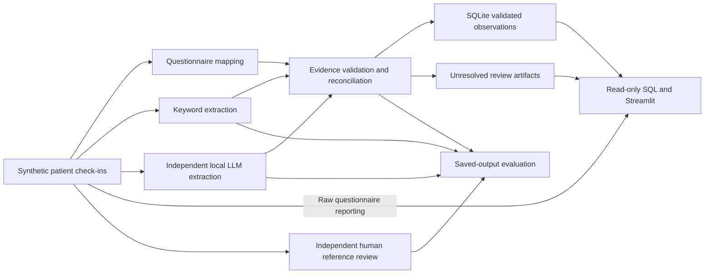

# Dr.Tracker · Track B

Dr.Tracker is a patient-reported data prototype for a Data Intelligence Engineering internship assignment. It follows five fictional patients submitting daily check-ins during head and neck cancer radiation therapy and chemotherapy. The prototype stores answers, extracts symptoms from free text, preserves unresolved evidence for review, and visualizes reporting trends. It uses synthetic data throughout.

## Architecture



SQLite keeps five tables. `patients` stores synthetic profiles and treatment start dates. `checkins` stores timestamps, raw questionnaire JSON, and free text. `symptoms` stores structured observations and their provenance. `weight` stores dated measurements, and `treatments` stores dated events. Foreign keys are enabled on every project connection.

Keyword rules and Qwen2.5:3b each read the original free text independently. Validation checks literal source evidence, status, supported numeric values, and timing. Reconciliation preserves rejected fields, potential duplicates, and unresolved source differences. The importer revalidates eligible answers, inserts them in one transaction, skips identical deterministic IDs, and rolls back on conflicting IDs.

| Data layer | Meaning |
| --- | --- |
| Raw questionnaire submissions | Original answers, including explicit zero, uncertainty, and missing values. |
| Validated questionnaire observations | 1,460 structured answers in SQLite. Automated validation passed and operational review is pending. |
| Unresolved free-text evidence | 177 review groups, including 120 text-parser agreements, retained outside the symptom table. |
| Independently reviewed evaluation annotations | Human-verified labels for comparing saved parser outputs on a selected sample. |
| Confirmed clinical events | The prototype does not establish them. |

## Run the saved demo

Install the pinned dependencies in `requirements.txt` and run `python -m streamlit run dashboard.py` from the project root. The dashboard reads `data/drtracker.db` and `data/phase3c1_reconciliation.json` from the same snapshot. Expand **Saved Ollama output · Qwen2.5:3b** to see the original synthetic check-in, saved extraction, and reconciliation status. No model server or credentials are needed.

For Streamlit Community Cloud, select `dashboard.py` as the entrypoint and Python 3.14 in Advanced settings. Leave Secrets empty. Use the rebuild steps below to regenerate the synthetic snapshot.

## Reproduce the offline demo

Use **Python 3.12 or newer** with SQLite **3.37 or newer**, including JSON functions. The schema uses STRICT tables and `json_valid()`. Analysis also uses `json_type()` and `json_extract()`. The documented workflow was verified on Windows with Python 3.14.10. The direct dashboard dependencies are pinned in `requirements.txt`.

From the project root in PowerShell:

```powershell
python -m venv .venv
$py = ".\.venv\Scripts\python.exe"
& $py -m pip install -r requirements.txt
& $py -m src.database
& $py -m src.seed_data
& $py -m src.insert_symptoms --dry-run
& $py -m src.insert_symptoms
& $py -m src.insert_symptoms --verify
& $py -m unittest discover -s tests -v
```

The seed module creates 143 check-ins, 56 weights, and 116 treatment events for five patients. The importer uses the included Phase 3C-1 report to reproduce the 1,460 validated observations. The default demo uses saved extraction artifacts and requires no API key, paid service, or running Ollama instance. Installing dependencies requires access to a Python package index.

```powershell
& $py -m streamlit run dashboard.py --server.address 127.0.0.1
# In a second terminal, open the separate annotation tool:
.\.venv\Scripts\python.exe -m streamlit run review_annotations.py --server.address 127.0.0.1 --server.port 8502
```

The physician dashboard displays original questionnaire scores, groups weekly vomiting submissions, selects the latest submitted valid weight per measurement date, and compares questionnaire scores in submission-date windows around treatment changes. P001 has raw pain scores and no validated pain scores. All seven positive vomiting responses are outside the validated subset. Questionnaire reporting windows are unknown, so submission dates describe reporting and weekly counts describe responses. Treatment comparisons are descriptive.

## Evaluate saved outputs

The purposive synthetic sample contains 36 independently reviewed check-ins and 45 reference mentions. Detection matches the same symptom and overlapping literal evidence within a check-in. Failed LLM check-ins remain in the recall denominator.

| Parser | TP | FP | FN | Precision | Recall | F1 |
| --- | ---: | ---: | ---: | ---: | ---: | ---: |
| Keyword | 43 | 0 | 2 | 100% | 95.6% | 97.7% |
| Qwen2.5:3b | 28 | 0 | 17 | 100% | 62.2% | 76.7% |

Zero false positives in this sample does not guarantee the same precision elsewhere. Strict evidence validation rejected unsupported claims and contributed to lower LLM recall. Parser agreement alone does not establish field-level correctness. Human annotation review for evaluation is separate from operational review of reconciliation groups.

```powershell
& $py -m src.evaluate --reference data/phase5_reference_verified_demo.json --output reproduced-evaluation.json
```

The publication reference preserves the reviewed labels and replaces reviewer identifiers with stable aliases. The annotation app starts from the draft unless local progress exists. It writes local progress separately and exposes export after all 36 check-ins are verified. Duplicate-pair scoring also requires verified pair labels. See the [evaluation report](PHASE_5_EVALUATION.md) and [SQL readiness notes](PHASE_3C_READINESS.md) for more detail.

## Optional extraction and publication

To rebuild deterministic questionnaire and keyword candidates from SQLite, run `python -m src.extract_symptoms`. Run `python -m src.reconcile_phase3c` to replay the captured LLM responses and regenerate the offline reconciliation report. For new model responses, use a **scratch copy** with [Ollama](https://ollama.com/download), pull `qwen2.5:3b`, and run `python -m src.reconcile_symptoms --limit 3`. That command replaces its saved outputs in the working copy. Live model output can vary and is separate from reproducing the published metrics.

Publish source, schema, tests, documentation, and the synthetic JSON assets. Include the rebuilt `data/drtracker.db` demo snapshot with its matching Phase 3C-1 report. The saved keyword and LLM exports, draft reference, and aliased verified demo reference support offline replay and evaluation. Keep other SQLite files, virtual environments, reviewer progress and downloads, caches, and credentials local.

Future work includes reviewing the unresolved groups, documenting questionnaire reporting windows, and evaluating more varied reports. This prototype supports report analysis rather than clinical diagnosis, confirmed episode counts, or causal claims.

## Physician review workspace

The patient dashboard uses original questionnaire answers for all scores and summaries under Patient-reported symptoms. Zero, missing, and uncertain remain distinct. No source selection is needed. Weekly vomiting count sums retain the unknown-period label. Medication comparisons in the expandable panel also use original questionnaire scores. The validated layer remains available through the analysis API for the existing integrity and evaluation workflow.

Reports to Clarify sits beside the symptom chart. It shows exact original text when saved extraction records contain failed attempts, rejected candidates or fields, uncertain or unmatched text, differing answers, potential repeats, or wording outside quoted evidence spans. Entries are deduplicated by check-in ID and paginated four at a time. Span coverage is a triage cue: uncovered words may be context, and a full-length quote cannot guarantee every symptom was extracted. Questionnaire/text differences with unknown periods are labeled timing unknown, not confirmed clinical conflicts.

Recent Patient Reports displays questionnaire answers and original statements. Detailed parser provenance and review reasons are expandable. No model requests or database writes occur during browsing. The schema and public annotation-review menu pages remain available.
